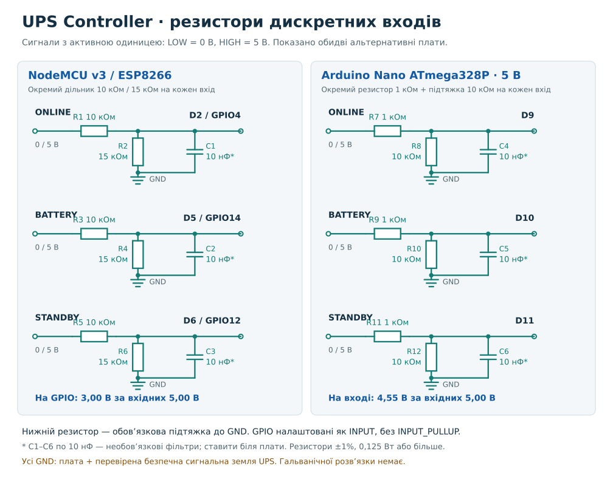
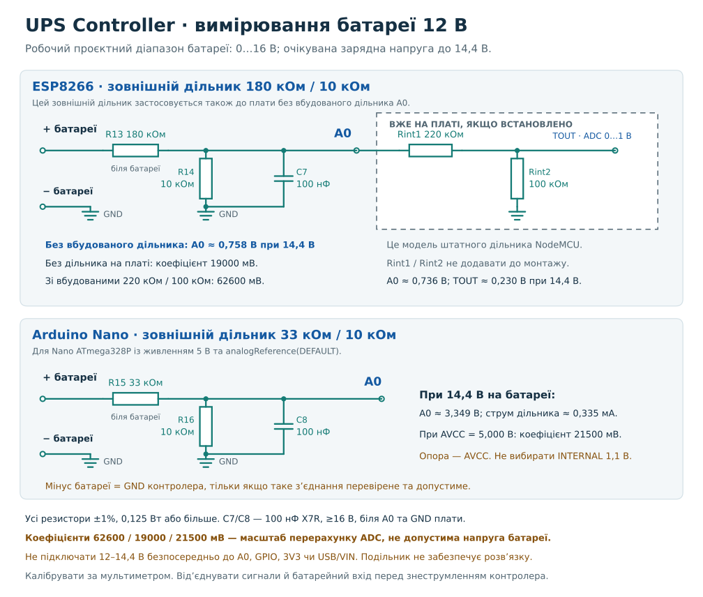
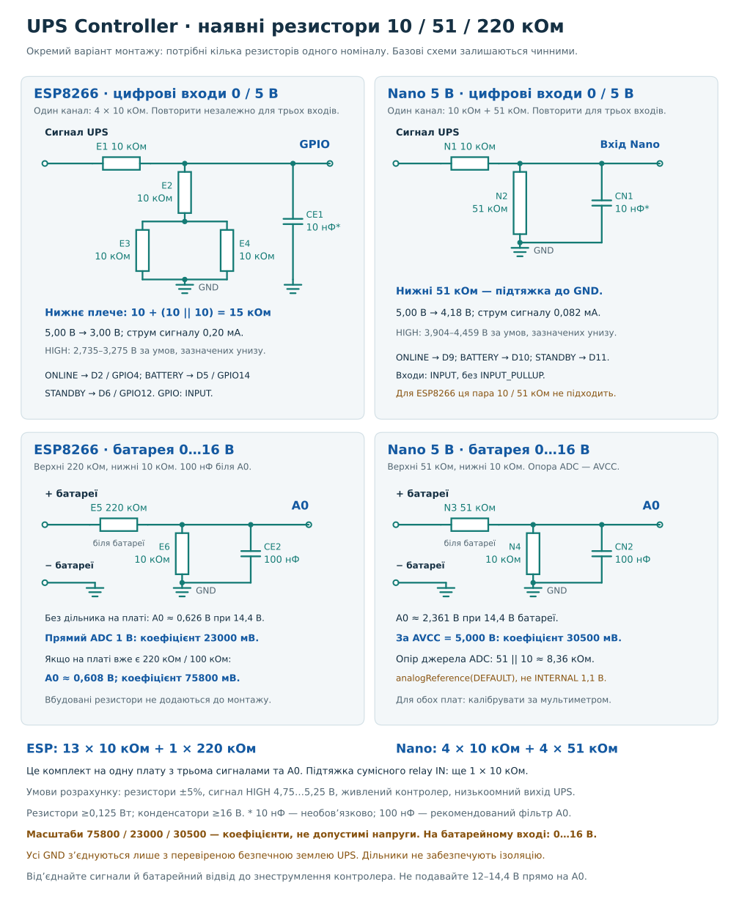

# Підключення до UPS

Вхідні умови цього варіанта: три дискретні сигнали **0 / 5 В, активний HIGH** та батарея **12 В із зарядною напругою до 14,4 В**. Для батарейного вимірювача прийнято проєктний діапазон **0–16 В**. Наведені номінали стосуються низькоомних логічних виходів; спосіб керування світлодіодами конкретного UPS і релейний модуль ще потрібно перевірити.

Схеми у векторному форматі, які можна збільшити або роздрукувати:

- [Дискретні входи 5 В: дільники й підтяжки для ESP8266 та Nano](hardware/digital-inputs.svg).
- [Батарея: дільник, фільтр і врахування A0 для обох плат](hardware/battery-divider.svg).
- [Альтернатива з наявних 10 кОм, 51 кОм і 220 кОм](hardware/available-resistors.svg): кількість деталей, послідовні й паралельні з'єднання, обидві плати.

## Призначення контактів

| Сигнал | Arduino Nano ATmega328P, 5 В | NodeMCU v3 ESP8266 | Призначення |
|---|---|---|---|
| RELAY | D8 | D1 / GPIO5 | Керування релейним модулем |
| ONLINE | D9 | D2 / GPIO4 | Зелений індикатор, дискретний вхід |
| BATTERY | D10 | D5 / GPIO14 | Жовтий індикатор, дискретний вхід |
| STANDBY | D11 | D6 / GPIO12 | Дежурне живлення від зовнішньої мережі |
| BATTERY VOLTAGE | A0 | A0 | Аналогове вимірювання напруги через окремий дільник |
| GND | GND | GND | Спільна перевірена низьковольтна земля |

Дискретний сигнал `BATTERY` і аналоговий вхід `A0` — **різні з'єднання**. Перший повідомляє про режим UPS за жовтим індикатором, другий вимірює напругу батареї.

Типово реле активне LOW, дискретні входи активні HIGH. Полярність ESP змінюється в панелі, Nano — у `BoardConfig.h`. Для зміни полярності ESP виберіть автоматичний режим «Вимкнено» й збережіть його разом із полярностями; перевірте входи, потім окремо ввімкніть автоматичний режим. GPIO0, GPIO2 та GPIO15 беруть участь у завантаженні ESP8266, тому ці сигнали використовують інші GPIO. Джерела: [NodeMCU GPIO](https://nodemcu.readthedocs.io/en/dev/modules/gpio/), [ESP8266EX Datasheet](https://documentation.espressif.com/0a-esp8266ex_datasheet_en.html).

## Сигнали 5 В → цифрові входи ESP8266

Для **кожного** з ONLINE, BATTERY, STANDBY встановіть власну пару:

| Елемент | Підключення | Номінал |
|---|---|---|
| R1 / R3 / R5 | Від сигналу 0/5 В до вузла GPIO | **10 кОм, ±1%** |
| R2 / R4 / R6 | Від того самого вузла GPIO до GND | **15 кОм, ±1%** |
| C1 / C2 / C3, необов'язково | Паралельно нижньому резистору, біля плати | **10 нФ, ≥16 В** |

Нижній резистор 15 кОм одночасно є **підтяжкою до землі (pull-down)**: при від'єднанні сигнального проводу GPIO отримує LOW. Внутрішню `INPUT_PULLUP` вмикати не потрібно; прошивка використовує `INPUT`. Не встановлюйте додаткову підтяжку до 5 В на вузол GPIO.

Номінальний розрахунок:

\[
V_{GPIO}=V_{signal}\frac{15}{10+15}=0{,}6V_{signal}
\]

Отже, 5,00 В перетворюються на **3,00 В**, а струм навантаження сигнального виходу становить **0,20 мА**. За 4,75–5,25 В на виході UPS та резисторів ±1% розрахований HIGH становить **2,827–3,175 В**. Мінімум HIGH ESP8266 дорівнює 0,75·VIO, тобто 2,475 В за VIO=3,3 В; 5 В прямо на GPIO неприпустимі. Джерело меж: [ESP8266EX Datasheet, Electrical Characteristics](https://documentation.espressif.com/0a-esp8266ex_datasheet_en.html). Числа дільника — розрахунок цього проєкту.

Ця схема припускає, що джерело справді формує 0/5 В під навантаженням. Вихід із відкритим колектором або високим внутрішнім опором потребує іншої схеми: його наявна підтяжка змінить коефіцієнт дільника. Не підключайтеся до контактів світлодіода лише за його кольором. Перед монтажем виміряйте HIGH і LOW щодо сигнальної землі, а після монтажу — напругу безпосередньо на GPIO.

`STANDBY` має означати наявність зовнішньої мережі, навіть коли вихід UPS вимкнений. Сигнал від батареї чи від комутованого виходу UPS для цього не підходить.

## Сигнали 5 В → цифрові входи Nano

Для Nano з живленням 5 В на кожному каналі використовується **1 кОм послідовно** (R7 / R9 / R11) і **10 кОм від входу до GND** (R8 / R10 / R12). При 5 В джерела вхід отримує приблизно **4,55 В**; струм — 0,455 мА. C4–C6 по 10 нФ можна встановити паралельно підтяжкам.

Пару 10 кОм / 15 кОм із ESP-варіанта сюди не переносіть: її 3,0 В дають малий або відсутній запас до гарантованого HIGH 5-вольтового ATmega328P. Поріг HIGH у робочому діапазоні живлення цього MCU — 0,6·VCC. Джерело: [Microchip ATmega328P Datasheet, DC Characteristics](https://docs.arduino.cc/resources/datasheets/Atmel-42735-8-bit-AVR-Microcontroller-ATmega328-328P_Datasheet.pdf).

## Вимірювання батареї на ESP8266

### Зовнішнє підключення

| Елемент | Підключення | Номінал |
|---|---|---|
| R13 | Від плюса батареї до A0 | **180 кОм, ±1%** |
| R14 | Від A0 до GND | **10 кОм, ±1%** |
| C7 | Від A0 до GND, паралельно R14 | **100 нФ X7R, ≥16 В** |
| Мінус батареї | До перевіреної спільної землі | GND |

Це окремий вимірювальний провід; він не живить плату. Верхній резистор R13 розмістіть біля точки відбору плюса батареї. Довгий провід без обмеження струму до цього резистора потребує окремого захисту біля батареї. Резистори 0,125 Вт або більше достатні за наведених напруг.

### Чому саме 180 кОм / 10 кОм

Сам чип ESP8266 допускає **0–1,0 В на TOUT**. У референсній платі NodeMCU DevKit v1.0 перед ним уже стоять **220 кОм послідовно та 100 кОм до GND**. Напис «NodeMCU v3» на іншій платі не підтверджує її точну схему. Джерела: [Espressif, ADC](https://documentation.espressif.com/0a-esp8266ex_datasheet_en.html), [оригінальна схема NodeMCU, аркуш ADC](https://github.com/nodemcu/nodemcu-devkit-v1.0/blob/master/NODEMCU_DEVKIT_V1.0.PDF).

Зовнішній дільник 180 кОм / 10 кОм залишає A0 нижче 1 В і без штатного дільника плати:

\[
V_{A0}=V_{battery}\frac{10}{180+10}=\frac{V_{battery}}{19}
\]

- 12,0 В → **0,632 В** на A0.
- 14,4 В → **0,758 В** на A0.
- 16,0 В → **0,842 В** номінально; не більше **0,859 В** у крайніх поєднаннях резисторів ±1%.

Ці межі стосуються працюючого контролера та усталеного сигналу. Подільник не є захистом від переполюсовки чи імпульсних перенапруг.

### Врахування штатного дільника NodeMCU

Вбудовані 220 кОм + 100 кОм навантажують зовнішні 10 кОм. Тому застосовувати тільки множник 19 або довільне «A0 = 3,3 В» до NodeMCU неправильно:

\[
R_{lower}=10\text{ кОм}\parallel(220+100)\text{ кОм}=9{,}69697\text{ кОм}
\]

\[
V_{TOUT}=V_{battery}\frac{9{,}69697}{180+9{,}69697}\frac{100}{220+100}
=\frac{V_{battery}}{62{,}6}
\]

За 14,4 В на батареї: **A0 ≈ 0,736 В**, **TOUT ≈ 0,230 В**, струм із батареї ≈ **75,9 мкА**. Rint1 / Rint2 на схемі показують уже встановлені на платі деталі; додавати їх до зовнішнього монтажу не потрібно.

| Фактичний аналоговий вхід | Початкове `full_scale_mv` | Номінальний крок на батареї |
|---|---:|---:|
| NodeMCU з вбудованими 220 кОм / 100 кОм | **62600** | ≈61 мВ на відлік |
| Прямий вхід ESP8266, діапазон 0–1 В | **19000** | ≈19 мВ на відлік |

**62600 мВ — коефіцієнт перерахунку ADC, а не дозвіл подавати 62,6 В.** Для цієї схеми лишається проєктний діапазон батареї **0–16 В**. Універсальність зовнішнього дільника зменшує використану частину шкали NodeMCU; для контролю напруги показуємо десяті вольта й калібруємо за мультиметром. Відсоток заряду з одного вимірювання напруги не визначається.

Стан `overrange` означає насичення ADC, а не перевищення фізичного проєктного діапазону. Понад 16 В ADC може ще не насититися; тому відсутність `overrange` не підтверджує безпечну напругу. Показ близько нуля також не доводить, що батарея від'єднана: такі самі дані можуть означати нульову напругу або несправний вимірювальний провід.

## Вимірювання батареї на Nano

Nano використовує **R15 = 33 кОм** від плюса батареї до A0, **R16 = 10 кОм** від A0 до GND та **C8 = 100 нФ** паралельно R16. За 14,4 В маємо **3,349 В** на A0; за 16 В — 3,721 В номінально. Струм дільника при 14,4 В — **0,335 мА**.

Джерело для ADC має еквівалентний опір 33 кОм || 10 кОм = **7,67 кОм**, що вкладається в рекомендацію Microchip приблизно до 10 кОм. Джерело: [Microchip, Analog Input Circuitry](https://docs.arduino.cc/resources/datasheets/Atmel-42735-8-bit-AVR-Microcontroller-ATmega328-328P_Datasheet.pdf).

Використовується стандартний режим опори Arduino `DEFAULT`: опорною напругою є AVCC. При AVCC=5,000 В початкове `full_scale_mv` дорівнює **21500**. Якщо виміряна AVCC інша, початковий масштаб дорівнює AVCC у мілівольтах × 4,3; після цього калібруйте за батареєю. Внутрішня опора 1,1 В для цього дільника не підходить.

У `firmware/arduino_nano/BoardConfig.h` це `BATTERY_FULL_SCALE_MV = 21500`. Для підключеного дільника ввімкніть `BATTERY_MEASUREMENT_ENABLED`, зберіть і завантажте прошивку. Показ читається через Serial 115200 командами `?` або `v`.

## Варіант із наявних 10 кОм, 51 кОм і 220 кОм

Це **альтернативний монтаж**, якщо резисторів 15, 180, 1 або 33 кОм немає. Потрібні кілька деталей одного номіналу; одного резистора кожного виду недостатньо. Дві попередні схеми та їхні коефіцієнти залишаються чинними для своїх номіналів.

### ESP8266: кожен цифровий вхід

Верхнє плече від сигналу 0/5 В до GPIO — **один 10 кОм**. Нижнє плече від GPIO до GND — **один 10 кОм послідовно з парою 10 кОм, з'єднаних паралельно**:

\[
R_{lower}=10+(10\parallel10)=10+5=15\text{ кОм}
\]

Отже, потрібно **4 × 10 кОм на канал, 12 × 10 кОм на три канали**. Весь нижній ланцюг є pull-down; вузол між його послідовним резистором і паралельною парою не з'єднують із GPIO. Для ONLINE, BATTERY та STANDBY збираються три незалежні копії, з'єднується тільки спільна земля. Необов'язкові 10 нФ встановлюються безпосередньо між GPIO і GND, паралельно **всьому** нижньому плечу. Прошивка залишається в режимі `INPUT`.

Номінально це той самий дільник 10/15 кОм: **3,000 В при 5,000 В**, струм **0,200 мА**. Якщо кожен резистор має допуск не гірший за **±5%**, а HIGH джерела лежить у межах **4,75–5,25 В**, крайні поєднання дають **2,735–3,275 В на GPIO**. Це забезпечує запас до порога 2,475 В за VIO=3,3 В. Ці числа не включають довільний внутрішній опір джерела та перехідні процеси.

Пару **10/10 кОм** не використовуйте як заміну: номінальні 2,5 В надто близькі до гарантованого HIGH ESP8266. Також 51 кОм зверху та 51+10 кОм знизу не забезпечують цей запас за зазначених ±5%: нижня розрахункова межа — 2,469 В.

### ESP8266: батарейний дільник 220 кОм / 10 кОм

Встановіть **220 кОм від плюса батареї до A0**, **10 кОм від A0 до GND** та **100 нФ X7R, ≥16 В** паралельно нижньому резистору. Верхній резистор розмістіть біля точки відбору плюса батареї. Умови щодо живлення, землі та знеструмленої плати ті самі, що для базової схеми.

| Фактичний аналоговий вхід | A0 при 14,4 В | TOUT при 14,4 В | Початкове `battery.full_scale_mv` |
|---|---:|---:|---:|
| Прямий ADC ESP8266, 0–1 В | 0,6261 В | 0,6261 В | **23000** |
| NodeMCU з підтвердженими внутрішніми 220 кОм / 100 кОм | 0,6079 В | 0,1900 В | **75800** |

Внутрішня мережа NodeMCU знову навантажує зовнішні 10 кОм: їхній еквівалент із 320 кОм становить 9,69697 кОм. Загальний коефіцієнт дорівнює **75,8**, а не 23 × 3,2. Номінальний крок на стороні батареї — приблизно 74 мВ для NodeMCU або 22 мВ для прямого ADC.

При 16 В батареї та зовнішніх резисторах ±5% напруга на прямому ADC не перевищує **0,766 В**; для плати з внутрішнім дільником вона ще менша. Це перевірка усталеного режиму, а не захист від викидів. **Дозволений проєктний діапазон батареї залишається 0–16 В**; 75800 — лише масштаб перерахунку.

Допуски впливають на масштаб: за зовнішніх ±5% і внутрішніх 220/100 кОм ±1% розрахований `full_scale_mv` може становити приблизно **68054–84469 мВ**; якщо внутрішні також ±5%, **64506–89305 мВ**. Тому для цього варіанта прошивка приймає коефіцієнт до **100000 мВ**, а попереднього ліміту 80000 мВ недостатньо для всіх таких комбінацій. Це оцінка лише похибок резисторів, без власної похибки ADC. Виміряйте реальні напруги та виконайте калібрування. Не залишайте стандартні **62600**, якщо встановлено зовнішні **220/10 кОм**.

### Nano 5 В: альтернативні цифрові входи й батарея

Для кожного цифрового входу використайте **10 кОм від сигналу до входу** та **51 кОм від входу до GND**. Номінально 5 В перетворюються на **4,180 В**, навантаження джерела — 0,082 мА. За сигналу 4,75–5,25 В і резисторів ±5% вхід отримує **3,904–4,459 В**, із запасом до HIGH 5-вольтового ATmega328P. Ця пара призначена для Nano; на ESP вона подає завелику напругу. За потреби 10 нФ встановлюються паралельно нижнім 51 кОм.

Для батареї використайте **51 кОм зверху**, **10 кОм до GND**, **100 нФ** від A0 до GND. При 14,4 В на A0 буде **2,361 В**; при 16 В та резисторах ±5% — не більше **2,850 В**. Опір джерела ADC становить **51 || 10 = 8,361 кОм**; навіть за обох резисторів +5% це менше 10 кОм.

За AVCC=5,000 В задайте **`BATTERY_FULL_SCALE_MV = 30500`**, а для фактичної іншої AVCC початковий масштаб дорівнює `AVCC_мВ × 6,1`. Увімкніть `BATTERY_MEASUREMENT_ENABLED`, перебудуйте й прошийте Nano. Опора — `DEFAULT`/AVCC, не внутрішня 1,1 В. Обов'язково звірте показ із мультиметром; стандартні 21500 стосуються базового дільника 33/10 кОм.

### Комплект деталей для альтернативного монтажу

| Деталь | ESP8266: три сигнали + батарея | Nano: три сигнали + батарея |
|---|---:|---:|
| 10 кОм, ≥0,125 Вт | **13 шт.** | **4 шт.** |
| 51 кОм, ≥0,125 Вт | — | **4 шт.** |
| 220 кОм, ≥0,125 Вт | **1 шт.** | — |
| 100 нФ X7R, ≥16 В | 1 шт. | 1 шт. |
| 10 нФ, ≥16 В, необов'язково | до 3 шт. | до 3 шт. |
| Додаткові 10 кОм для сумісного active-LOW relay IN | +1 шт. за потреби | +1 шт. за потреби |

Додаткова підтяжка реле підключається до **3V3 ESP** або **5 В Nano**, лише за умов розділу про реле. Наведені граничні розрахунки припускають резистори з допуском не гіршим за ±5%. Якщо їхній допуск невідомий, перевірте маркування та опір мультиметром; сам перелік номіналів не підтверджує ні точність, ні кількість деталей.

## Підключення й калібрування

1. Від'єднайте релейний контакт від кнопки UPS. Перевірте, що мінус батареї та сигнальна земля дійсно належать до безпечної низьковольтної частини й допускають з'єднання з GND контролера.
2. Зберіть дільники. Перевірте омметром, що верхній і нижній резистори не переплутані, а нижні резистори приєднані до GND.
3. Спочатку виміряйте вихід батарейного дільника мультиметром без підключення A0. Для базової схеми при 14,4 В очікується приблизно 0,758 В на ESP або 3,349 В на Nano; після підключення NodeMCU із вбудованим дільником — 0,736 В. Для альтернативних резисторів очікується 0,626 В на ESP без підключеної плати, 0,608 В після підключення NodeMCU із внутрішніми 220/100 кОм або 2,361 В на Nano.
4. З живленим контролером під'єднайте GND, узгоджені сигнали та A0. Перевірте цифрові рівні й поведінку індикаторів перед дозволом автоматики.
5. Увімкніть вимірювання батареї та виберіть початковий масштаб, який відповідає схемі плати. Типово вимірювання вимкнене: на ESP це `battery.enabled = false`, на Nano — `BATTERY_MEASUREMENT_ENABLED = false`. На ESP масштаб — `battery.full_scale_mv`, на Nano — `BATTERY_FULL_SCALE_MV` у `BoardConfig.h`.
6. За стабільної напруги одночасно зніміть показ мультиметра на клемах батареї та показ контролера. Калібрування масштабу: `новий масштаб = старий масштаб × показ мультиметра / показ контролера`. Не калібруйте при нульовому показі, насиченні ADC або під час зміни навантаження.
7. Перевірте показ ще в другій точці, наприклад близько 12 В і під час заряду. Середнє кількох відліків зменшує шум, але не усуває похибку резисторів, опори й самого ADC.

Поріг попередження про низьку напругу вибирайте за характеристиками конкретної батареї та навантаження. Типове значення `battery.low_warning_mv = 0` / `BATTERY_LOW_WARNING_MV = 0` вимикає це попередження. Напруга сама по собі не підтверджує відсоток заряду, залишковий час або допустимий поріг вимкнення UPS; вимірювач не замінює штатний захист батареї.

## Земля, живлення та знеструмлений контролер

Резистивні дільники **не забезпечують гальванічної розв'язки**. Спільне GND допустиме лише після перевірки електричної схеми UPS. Не з'єднуйте USB-комп'ютер із неперевіреною внутрішньою землею UPS. Якщо потрібна ізоляція, дискретні сигнали передаються через оптрони, а напруга батареї — через ізольований вимірювальний тракт.

Резистор обмежує струм, але не гарантує відсутності зворотного живлення через входи знеструмленої плати. Контролер у цій схемі має залишатися живленим, поки сигнали й батарейний відвід підключені. Для обслуговування спочатку від'єднуйте їх; постійна робота зі знеструмленим контролером потребує окремого апаратного відключення або ізоляції входів.

Контролер повинен отримати живлення до ввімкнення виходу UPS. Для NodeMCU використовуйте стабілізовані 5 В через USB від незалежного джерела або відповідного перетворювача. **Батарея 12–14,4 В не підключається безпосередньо до USB/VIN, 3V3 або GPIO.** Джерело живлення враховує піки Wi-Fi й окремо струм котушки реле. Espressif рекомендує для самого чипа 3,3 В джерело з можливістю віддавати 500 мА: [Hardware Design Guidelines, Power Supply](https://documentation.espressif.com/esp8266_hardware_design_guidelines_en.html).

## Реле та штатна кнопка

Контакти **COM–NO** малосигнального реле підключаються паралельно перевіреним низьковольтним контактам штатної кнопки. Котушка до GPIO не підключається: потрібен релейний модуль або драйвер із захистом котушки.

Для релейного входу active LOW, який справді сумісний із 3,3 В, можна встановити **10 кОм від D1/GPIO5 до 3V3**: це підтяжка в OFF під час reset за наявного живлення 3V3. Для Nano еквівалентна підтяжка D8 — до його 5 В. Це окрема функція від pull-down на вимірювальних входах.

Якщо `IN` релейного модуля вже підтягується до 5 В, до ESP його безпосередньо не приєднують. Потрібен перевірений буфер або ізольований інтерфейс; його інверсію слід врахувати у `BoardConfig.h`. Підтяжка до 3V3 не забезпечує OFF при відсутній 3V3 і працюючому живленні реле — цей режим перевіряється апаратно. Прошивка виставляє OFF до `OUTPUT`, але стан до старту коду визначає схема.

Тривалості запуску й вимкнення задаються окремо; типово 2 с. Перевірте, що вони відповідають кнопці вашого UPS. Проєкт не визначає з'єднань із 230 В і не використовує це реле для комутації силового входу або виходу UPS.

## Деталі для одного контролера: базова схема

| Деталь | ESP8266 | Nano 5 В |
|---|---:|---:|
| 10 кОм, ±1%, ≥0,125 Вт | 4 шт. + 1 шт. для сумісного relay IN за потреби | 4 шт. + 1 шт. для relay IN за потреби |
| 15 кОм, ±1%, ≥0,125 Вт | 3 шт. | — |
| 1 кОм, ±1%, ≥0,125 Вт | — | 3 шт. |
| 180 кОм, ±1%, ≥0,125 Вт | 1 шт. | — |
| 33 кОм, ±1%, ≥0,125 Вт | — | 1 шт. |
| 100 нФ X7R, ≥16 В | 1 шт. | 1 шт. |
| 10 нФ, ≥16 В, необов'язковий фільтр | до 3 шт. | до 3 шт. |

Вихідні SVG створюються скриптом [hardware/draw_schematics.py](hardware/draw_schematics.py) із точними з'єднаннями та номіналами. Для їх редагування потрібен Python із Matplotlib; для збирання прошивки ця залежність не потрібна.
